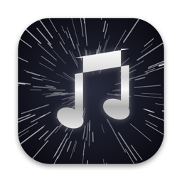
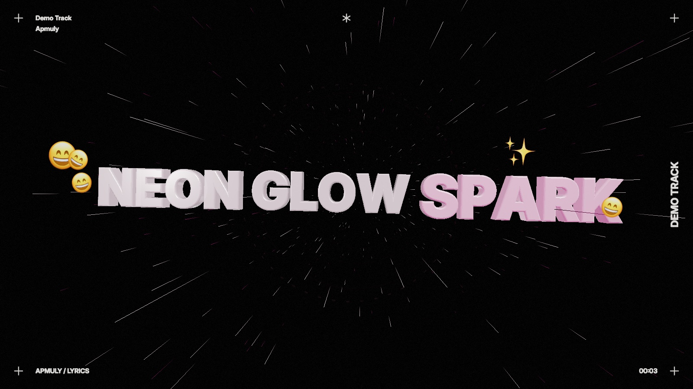
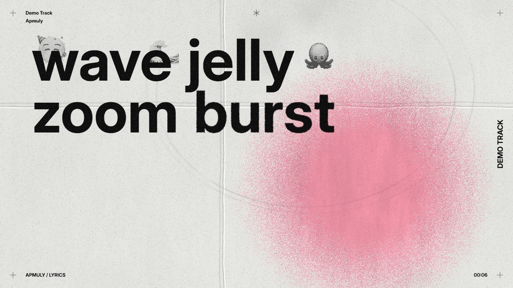
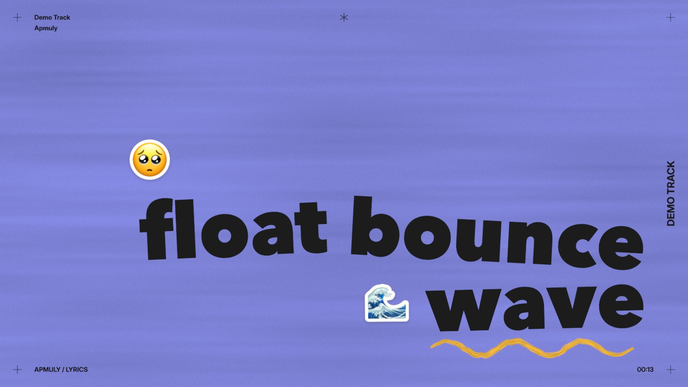
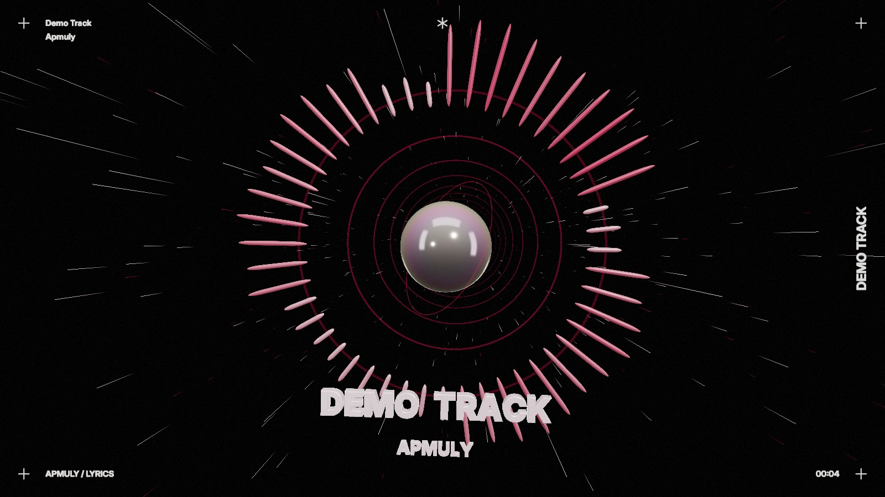

<p align="center">
  
</p>

<h1 align="center">Apmuly</h1>

<p align="center">
  <b>See the song you're playing in Apple Music or Spotify — on Mac and Windows.</b><br>
  Every word lands the moment it's sung, in three themes coloured by the album art, with emoji for the mood and
  the things it mentions — and songs without lyrics become an audio visualizer.
</p>

<p align="center">
  <a href="#download">Download</a> ·
  <a href="#install-on-mac">Install on Mac</a> ·
  <a href="#install-on-windows">Install on Windows</a> ·
  <a href="#using-apmuly">Use</a> ·
  <a href="#build-from-source">Build from source</a> ·
  <a href="#privacy">Privacy</a>
</p>

| Kinetic Depth | Grunge |
|---|---|
|  |  |
| **Paper Brush** | **Visualizer** (songs without lyrics) |
|  |  |

<sub>Screenshots use the built-in demo with placeholder words.</sub>

---

## Features

- **Works with Apple Music and Spotify** — open Apmuly and play anything in the Apple Music or Spotify desktop app. It
  follows whichever app is playing, or press **S** (or use the **Source** menu) to pin one.
- **Lyrics in sync** — time-synced lyrics from [LRCLIB](https://lrclib.net), tracked to the millisecond, through
  pauses, seeks, skips and **AutoMix / crossfade** transitions.
- **Every word on the singer's beat** — most lyric files only time whole lines, so Apmuly paces the words itself:
  - **Live vocal onsets** — it watches the voice range of the music and starts each word the moment the singer
    does, nudging the rest of the line if they're early or late. It calibrates itself to your speakers' delay and
    stays hands-off when the mix is too busy to tell the voice apart (press **P** to compare with it off).
  - **Learned timing** (macOS 14.2+) — on-device speech recognition pins words to when they were heard, carries
    that to repeated choruses, and remembers it for the next play.
  - **A good first guess** — before either kicks in, words are spaced the way they're usually sung: filler words
    quick, the last word of a line held, a breath at commas.
- **Three themes** (press **1** / **2** / **3**, or **T** to cycle):
  - **Kinetic Depth** — satin 3D words fly out of warp-speed streaks and land as they're sung, laid out like a
    poster; the sung word glows in the song's colour; finished lines rocket past the camera. Everything moves to the beat.
  - **Grunge** — distressed poster typography: black grotesk words spray onto creased paper out of a grainy blur as
    they're sung, over soft spray paint in the album's colour; every line gets a new layout; emoji are printed as
    ink stamps.
  - **Paper Brush** — hand-made kinetic type: bold words pop onto notebook paper, painted colour or a starry night as
    they're sung, while brush doodles draw themselves around them (circles, underlines, arrows, sparkles); emoji
    are die-cut stickers.
- **A printed frame** — every theme shows the song and artist, a running timer and print marks around the edges.
- **Album-art colours** — every theme takes its colours from the song's artwork and cross-fades between songs.
- **Emoji that fit the song** — a mood emoji for each expressive line and emoji for the things it mentions
  (🌙 🚗 💃 …), worked out privately on your computer.
- **Any window size** — words, emoji and the visualizer re-fit to wide, tall, small or full-screen windows.
- **Visualizer** — songs without lyrics (and instrumental breaks) become a spectrum ring driven by the music, with
  the song title; Grunge and Paper Brush show it their own way.
- **Lyrics mode** — press **L** for the whole song as a scrolling sheet, filling word by word on the singer's timing.
- **Auto-sync** — Apmuly listens to the singer (on-device speech recognition) to correct lyric files that are
  early or late, and compensates for Bluetooth headphone delay.

## Download

Every [release](https://github.com/rushyendra28/apmuly/releases/latest) has the Mac and the Windows app side by side —
pick the file for your computer under **Assets**:

| Your computer | Download | Then |
|---|---|---|
| **Mac** (Apple silicon or Intel) | `Apmuly-x.y.z.dmg` | [Install on Mac](#install-on-mac) |
| **Windows PC** (most PCs: Intel / AMD) | `Apmuly-Windows-x.y.z-x64.zip` | [Install on Windows](#install-on-windows) |
| **Windows on ARM** (e.g. Snapdragon laptops) | `Apmuly-Windows-x.y.z-arm64.zip` | [Install on Windows](#install-on-windows) |

<sub>Not sure which Windows file? Open **Settings → System → About**: "x64-based processor" → `x64`, "ARM-based
processor" → `arm64`. Checksums: `Apmuly-x.y.z.dmg.sha256` (Mac) and `SHA256SUMS-windows.txt` (Windows).</sub>

## Requirements

| | Mac | Windows |
|---|---|---|
| **System** | macOS 12 (Monterey) or later — Apple silicon or Intel | Windows 10 (version 1809) or later, or Windows 11 — x64 or ARM64 |
| **Music** | The Music app (Apple Music or your library) or the Spotify desktop app | [Apple Music for Windows](https://apps.microsoft.com/detail/9pfhdd62mxs1) or the Spotify desktop app |
| **Internet** | To look up lyrics | To look up lyrics |
| **Also needed** | — | Microsoft Edge WebView2 Runtime (built into Windows 11 and up-to-date Windows 10) |
| **Optional** | [Apple Intelligence](https://support.apple.com/en-us/121115) (macOS 26, Apple silicon) for the best emoji; otherwise a simpler built-in analysis | — |

On the Mac everything works on macOS 12. A few extras need newer versions:

| Feature | macOS |
|---|---|
| Synced lyrics, all three themes, album-art colours, Lyrics mode, emoji | 12+ |
| Visuals that move to the music's beat, spectrum visualizer, live vocal-onset pacing | 14.2+ (needs audio capture; earlier versions pulse with the words instead) |
| Auto-sync and learned singer timing | 14.2+ (needs audio capture and on-device speech recognition) |
| Emoji from Apple's on-device language model | 26+ with Apple Intelligence |

## Install on Mac

1. Download **`Apmuly-x.y.z.dmg`** from the [latest release](https://github.com/rushyendra28/apmuly/releases/latest).
2. Open it and drag **Apmuly** into **Applications**.
3. **First launch only:** Apmuly is free and open source, but isn't notarized by Apple (that needs a paid
   developer account), so macOS asks you to approve it once:
   1. Open Apmuly from Applications. macOS says it can't verify the app — click **Done**.
   2. Open **System Settings → Privacy & Security**, scroll down to **Security**, and click **Open Anyway**
      next to the message about Apmuly. Confirm with your password or Touch ID.
   3. Apmuly opens. From now on it launches normally.

   <details>
   <summary>Prefer Terminal?</summary>

   ```sh
   xattr -dr com.apple.quarantine /Applications/Apmuly.app
   ```
   This removes the "downloaded from the internet" flag so the app opens directly. Only do this for apps you trust.
   </details>

   You can check the download against the `.sha256` file in the release: `shasum -a 256 Apmuly-x.y.z.dmg`.

### Permissions

The first time you play a song, macOS asks for these:

| Prompt | Why | Required? |
|---|---|---|
| **"Apmuly" wants access to control "Music"** / **"Spotify"** | To read which song is playing and where you are in it (asked for each app the first time you use it) | **Yes** — click **OK** |
| **Capture audio from other apps** (macOS 14.2+) | So the visuals move to the beat, words start when the singer does, the visualizer has a spectrum, and auto-sync can hear the singer. Nothing is recorded or saved. | Recommended |
| **Speech recognition** (if asked) | Auto-sync and singer-paced words, on-device only | Optional |

You can change these later in **System Settings → Privacy & Security** (Automation, Screen & System Audio
Recording, Speech Recognition).

## Install on Windows

The Windows app has the same three themes, Lyrics mode and live singer pacing. It follows **Apple Music for Windows**
(or any player that shows up in Windows' media controls) and hears the music through audio loopback.

1. Download **`Apmuly-Windows-x.y.z-x64.zip`** (or **`-arm64.zip`**, see [Download](#download)) from the
   [latest release](https://github.com/rushyendra28/apmuly/releases/latest).
2. Right-click the zip → **Extract All…**, and choose a folder you'll keep (for example `Documents\Apmuly`).
   Run it from the extracted folder, not from inside the zip.
3. Open **`Apmuly.exe`**. The first time, Windows SmartScreen may say it "protected your PC" because the app isn't
   code-signed — click **More info → Run anyway**.
4. Play a song in Apple Music. Click the Apmuly window once so it receives your key presses.

No installer, nothing written outside the folder except settings and cached lyrics in `%LOCALAPPDATA%\Apmuly`. To
uninstall, delete the folder (and that one, if you like). See [`windows/README.md`](windows/README.md) for details,
building from source and what differs from the Mac version.

## Using Apmuly

1. Open **Music** and play a song.
2. Open **Apmuly** — lyrics appear when the song has synced lyrics; otherwise you get the visualizer.

| Key | Action |
|---|---|
| **L** or **⌘L** | Switch between **Visualizer** (3D) and **Lyrics** (scrolling sheet) |
| **1** / **2** / **3** (or **⌘1**–**⌘3**) | **Kinetic Depth** / **Grunge** / **Paper Brush** theme (remembered) |
| **T** or **⌘T** | Next theme |
| **P** | Turn live singer pacing off / on (to compare; remembered) |
| **E** | Emoji on / off (remembered) |
| **S** | Source: Automatic (whichever app is playing) → Apple Music → Spotify (remembered) |
| **]** / **[** | Show lyrics later / earlier by 0.05 s (remembered per song) |
| **0** | Reset that adjustment |
| **R** | Retry if lyrics failed to load |

Make the window full screen with the green button (or **⌃⌘F**) for the best show.

The bar at the bottom shows how timing is being handled, e.g. `auto-synced −0.27s · output +0.18s`:
*auto-synced* is the correction measured from the singer, *output* is your headphones' delay, and *nudge*
is your own adjustment.

## Privacy

- **Lyrics lookup:** Apmuly sends the song's title, artist, album and length to [lrclib.net](https://lrclib.net). That's
  the only thing that leaves your Mac.
- **Everything else stays on your Mac:** mood/emoji analysis (Apple's on-device model or NaturalLanguage), speech
  recognition for auto-sync, and the audio analysis. Audio is never recorded, saved or sent anywhere, and lyric text
  isn't logged.
- **Stored data:** found lyrics and learned word timings (word positions and times only) are kept in
  `~/Library/Application Support/apmuly/` (delete the folder to clear them); settings live in the app's preferences.

## Troubleshooting

| Problem | Fix |
|---|---|
| "Apmuly can't be opened" / "is damaged" (Mac) | See [Install on Mac → First launch](#install-on-mac). |
| "Windows protected your PC" | Click **More info → Run anyway** (the app isn't code-signed). |
| Windows: no song detected | Make sure Apple Music for Windows is playing and shows in the volume flyout's media controls. |
| Windows: the window is blank | Install the [WebView2 Runtime](https://developer.microsoft.com/microsoft-edge/webview2/). |
| Nothing happens / "needs permission" message | Allow Apmuly under **Privacy & Security → Automation → Apmuly → Music**. To start over: `tccutil reset AppleEvents io.github.rushyendra28.apmuly` |
| Visuals don't move with the music; no spectrum | Allow Apmuly under **Privacy & Security → Screen & System Audio Recording**. |
| "No lyrics found" / visualizer instead of lyrics | LRCLIB has no synced lyrics for that track (common for remixes, sped-up edits, classical). |
| Lyrics a little early or late | Press **]** or **[**. Auto-sync also corrects this after a few lines when it can hear the vocals clearly. |
| Words run ahead of or behind the singer | Live pacing follows the singer's vocal onsets; press **P** to compare with it off. On the Mac (14.2+) Apmuly also learns the singer's timing, so choruses and later plays get it right from the start. |
| Spotify not detected | Use the Spotify **desktop app** (the web player and playing on another device via Connect aren't visible). Press **S** to check the source isn't pinned to Apple Music. |
| Lyrics briefly wrong after skipping | They catch up within a second; Apmuly checks Music twice a second. |

## Build from source

You need **Xcode 26+** (building requires a Mac on macOS 26+; the app itself runs on macOS 12+),
[Homebrew](https://brew.sh), and **Node 22+** (only for the renderer tests).

```sh
git clone https://github.com/rushyendra28/apmuly.git
cd apmuly
make setup    # installs XcodeGen
make run      # generates Apmuly.xcodeproj, builds and launches the app
```

Prefer Xcode? `make project && open Apmuly.xcodeproj`, choose the **Apmuly** scheme and press Run.

Other tasks: `make test` (all tests), `make previews` (render the stage with placeholder words in headless Chrome),
`make help` (everything).

**Signing:** builds are ad-hoc signed, so no Apple account is needed. macOS remembers permissions per signature, so
each rebuild asks again. To stop that, create a stable local identity once:

```sh
scripts/create-signing-identity.sh
cp Config/Local.xcconfig.example Config/Local.xcconfig   # then uncomment CODE_SIGN_IDENTITY
make project
```

### Making a release

Mac and Windows ship in the same GitHub release:

1. Set the version in [`Config/Base.xcconfig`](Config/Base.xcconfig) (`MARKETING_VERSION`) and
   [`windows/Directory.Build.props`](windows/Directory.Build.props) (`Version`).
2. `make release` builds a universal Mac app and creates `dist/Apmuly-<version>.dmg` plus a `.sha256` checksum.
3. Push a tag `v<version>` and create the release for it with the DMG and checksum attached. The
   [Windows workflow](.github/workflows/windows.yml) builds, tests and attaches `Apmuly-Windows-<version>-x64.zip`,
   `-arm64.zip` and `SHA256SUMS-windows.txt` to that same release.

With an Apple Developer ID you can sign and notarize, so users don't need the first-launch step:

```sh
xcrun notarytool store-credentials apmuly-notary       # once
SIGN_IDENTITY="Developer ID Application: Your Name (TEAMID)" TEAM_ID=TEAMID \
NOTARY_PROFILE=apmuly-notary make release
```

## How it works

```
Music.app ──Apple Events──▶ Music bridge ──▶ Playback tracker (AutoMix-aware clock)
                                                     │
LRCLIB ──▶ Lyrics service (cache) ──▶ Lyric timeline ┤   (re-timed to the singer's pace)
                                                     │
Music audio ──process tap──▶ beat · spectrum ────────┤
              └──▶ speech recognition ──▶ auto-sync ─┤
Lyrics ──▶ on-device model ──▶ mood & emoji ─────────┤
Artwork ──▶ palette ─────────────────────────────────┴──▶ Stage (three.js in WKWebView)
                                                            ├─ vocal onsets ──▶ live word pacing
                                                            ├─ Kinetic Depth · Grunge · Paper Brush
                                                            └─ Lyrics mode sheet
```

The Windows app hosts the same stage in WebView2 and feeds it from Windows' media controls and audio loopback.

| Path | What |
|---|---|
| [`Packages/ApmulyCore`](Packages/ApmulyCore) | Pure Swift, fully tested: LRC parsing, LRCLIB client and cache, playback tracking, lyric↔singer matching and calibration, emoji/emotion planning, album-art palettes |
| [`App/Sources`](App/Sources) | The app: Music bridge, Core Audio tap, speech/emoji analysis, SwiftUI views, renderer bridge |
| [`App/Resources/Renderer`](App/Resources/Renderer) | The stage, shared by both apps: three themes (three.js), live singer pacing, the Lyrics-mode sheet |
| [`windows/`](windows) | The Windows app (C# / .NET 10, WPF + WebView2) and its tested core library |
| [`project.yml`](project.yml), [`Config/`](Config) | XcodeGen project spec and build settings |
| [`scripts/`](scripts) | Release, icon, signing-identity and preview tools |

## Contributing

Issues and pull requests are welcome — see [CONTRIBUTING.md](CONTRIBUTING.md). Please never include real lyrics in
issues, tests or screenshots.

## Credits & license

Apmuly is released under the [MIT License](LICENSE). It uses [three.js](https://threejs.org) and the
[Inter](https://rsms.me/inter/) typeface (SIL OFL), and gets lyrics from [LRCLIB](https://lrclib.net) — see
[THIRD_PARTY_NOTICES.md](THIRD_PARTY_NOTICES.md).

Apmuly is an independent project and is not affiliated with, endorsed by, or sponsored by Apple Inc. Apple Music
and Music are trademarks of Apple Inc. Lyrics are fetched at runtime for personal display and belong to their
respective rights holders; none are distributed with this project.
