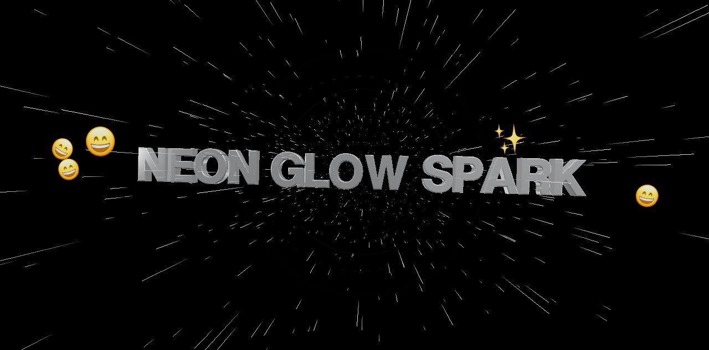
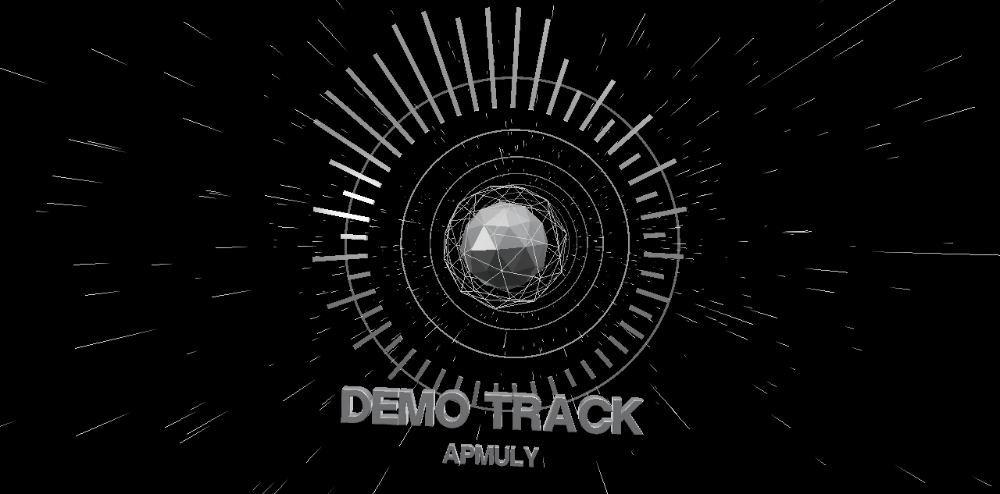

<p align="center">
  
</p>

<h1 align="center">Apmuly</h1>

<p align="center">
  <b>See the song you're playing in Apple Music.</b><br>
  Lyrics fly through 3D space in time with the singer, with emoji for the mood and the things it mentions —
  and songs without lyrics become an audio visualizer.
</p>

<p align="center">
  <a href="https://github.com/rushyendra28/apmuly/releases/latest">Download</a> ·
  <a href="#install">Install</a> ·
  <a href="#using-apmuly">Use</a> ·
  <a href="#build-from-source">Build from source</a> ·
  <a href="#privacy">Privacy</a>
</p>

| Lyrics in Kinetic Depth | Visualizer (songs without lyrics) |
|---|---|
|  |  |

<sub>Screenshots use the built-in demo with placeholder words.</sub>

---

## Features

- **Works with the Music app** — open Apmuly and play anything in Apple Music: streaming, your library, playlists.
- **Lyrics in sync** — time-synced lyrics from [LRCLIB](https://lrclib.net), tracked to the millisecond, through
  pauses, seeks, skips and **AutoMix / crossfade** transitions.
- **Kinetic Depth** — chrome words fly out of warp-speed streaks and land exactly as they're sung; the word
  being sung pushes toward you; finished lines rocket past the camera. Everything moves to the beat.
- **Emoji that fit the song** — a mood emoji for each expressive line and emoji for the things it mentions
  (🌙 🚗 💃 …), worked out privately on your Mac.
- **Visualizer** — songs without lyrics (and instrumental breaks) become a chrome spectrum ring driven by the
  music, with the song title in chrome.
- **Lyrics mode** — press **L** for a clean, scrolling lyrics sheet with word-by-word highlighting.
- **Auto-sync** — Apmuly listens to the singer (on-device speech recognition) to correct lyric files that are
  early or late, and compensates for Bluetooth headphone delay.

## Requirements

| | |
|---|---|
| **macOS** | 26 (Tahoe) or later — Apple silicon or Intel |
| **Music** | The Music app with an Apple Music subscription, or songs in your library |
| **Internet** | To look up lyrics |
| **Optional** | [Apple Intelligence](https://support.apple.com/en-us/121115) turned on (Apple silicon) for the best emoji. Without it, Apmuly uses a simpler built-in analysis. |

## Install

1. Download **`Apmuly-x.y.z.dmg`** from the [latest release](https://github.com/rushyendra28/apmuly/releases/latest).
2. Open it and drag **Apmuly** into **Applications**.
3. **First launch only:** Apmuly is free and open source, but isn't notarized by Apple (that needs a paid
   developer account), so macOS asks you to approve it once:
   1. Open Apmuly from Applications. macOS says it can't verify the app — click **Done**.
   2. Open **System Settings → Privacy & Security**, scroll down to **Security**, and click **Open Anyway**
      next to the message about Apmuly. Confirm with your password or Touch ID.
   3. Apmuly opens. From now on it launches normally.

   <details>
   <summary>Prefer Terminal?</summary>

   ```sh
   xattr -dr com.apple.quarantine /Applications/Apmuly.app
   ```
   This removes the "downloaded from the internet" flag so the app opens directly. Only do this for apps you trust.
   </details>

   You can check the download against the `.sha256` file in the release: `shasum -a 256 Apmuly-x.y.z.dmg`.

### Permissions

The first time you play a song, macOS asks for these:

| Prompt | Why | Required? |
|---|---|---|
| **"Apmuly" wants access to control "Music"** | To read which song is playing and where you are in it | **Yes** — click **OK** |
| **Capture audio from other apps** | So the visuals move to the beat, the visualizer has a spectrum, and auto-sync can hear the singer. Nothing is recorded or saved. | Recommended |
| **Speech recognition** (if asked) | Auto-sync, on-device | Optional |

You can change these later in **System Settings → Privacy & Security** (Automation, Screen & System Audio
Recording, Speech Recognition).

## Using Apmuly

1. Open **Music** and play a song.
2. Open **Apmuly** — lyrics appear when the song has synced lyrics; otherwise you get the visualizer.

| Key | Action |
|---|---|
| **L** or **⌘L** | Switch between **Visualizer** (3D) and **Lyrics** (scrolling sheet) |
| **]** / **[** | Show lyrics later / earlier by 0.05 s (remembered per song) |
| **0** | Reset that adjustment |
| **R** | Retry if lyrics failed to load |

Make the window full screen with the green button (or **⌃⌘F**) for the best show.

The bar at the bottom shows how timing is being handled, e.g. `auto-synced −0.27s · output +0.18s`:
*auto-synced* is the correction measured from the singer, *output* is your headphones' delay, and *nudge*
is your own adjustment.

## Privacy

- **Lyrics lookup:** Apmuly sends the song's title, artist, album and length to [lrclib.net](https://lrclib.net). That's
  the only thing that leaves your Mac.
- **Everything else stays on your Mac:** mood/emoji analysis (Apple's on-device model or NaturalLanguage), speech
  recognition for auto-sync, and the audio analysis. Audio is never recorded, saved or sent anywhere, and lyric text
  isn't logged.
- **Stored data:** found lyrics are cached in `~/Library/Application Support/apmuly/` (delete the folder to clear it);
  settings live in the app's preferences.

## Troubleshooting

| Problem | Fix |
|---|---|
| "Apmuly can't be opened" / "is damaged" | See [Install → First launch](#install). |
| Nothing happens / "needs permission" message | Allow Apmuly under **Privacy & Security → Automation → Apmuly → Music**. To start over: `tccutil reset AppleEvents io.github.rushyendra28.apmuly` |
| Visuals don't move with the music; no spectrum | Allow Apmuly under **Privacy & Security → Screen & System Audio Recording**. |
| "No lyrics found" / visualizer instead of lyrics | LRCLIB has no synced lyrics for that track (common for remixes, sped-up edits, classical). |
| Lyrics a little early or late | Press **]** or **[**. Auto-sync also corrects this after a few lines when it can hear the vocals clearly. |
| Lyrics briefly wrong after skipping | They catch up within a second; Apmuly checks Music twice a second. |

## Build from source

You need **macOS 26+**, **Xcode 26+**, [Homebrew](https://brew.sh), and **Node 22+** (only for the renderer tests).

```sh
git clone https://github.com/rushyendra28/apmuly.git
cd apmuly
make setup    # installs XcodeGen
make run      # generates Apmuly.xcodeproj, builds and launches the app
```

Prefer Xcode? `make project && open Apmuly.xcodeproj`, choose the **Apmuly** scheme and press Run.

Other tasks: `make test` (all tests), `make previews` (render the stage with placeholder words in headless Chrome),
`make help` (everything).

**Signing:** builds are ad-hoc signed, so no Apple account is needed. macOS remembers permissions per signature, so
each rebuild asks again. To stop that, create a stable local identity once:

```sh
scripts/create-signing-identity.sh
cp Config/Local.xcconfig.example Config/Local.xcconfig   # then uncomment CODE_SIGN_IDENTITY
make project
```

### Making a release

```sh
make release
```

This builds a universal app and creates `dist/Apmuly-<version>.dmg` plus a `.sha256` checksum, ready to attach to a
GitHub release. Set the version in [`Config/Base.xcconfig`](Config/Base.xcconfig) (`MARKETING_VERSION`).

With an Apple Developer ID you can sign and notarize, so users don't need the first-launch step:

```sh
xcrun notarytool store-credentials apmuly-notary       # once
SIGN_IDENTITY="Developer ID Application: Your Name (TEAMID)" TEAM_ID=TEAMID \
NOTARY_PROFILE=apmuly-notary make release
```

## How it works

```
Music.app ──Apple Events──▶ Music bridge ──▶ Playback tracker (AutoMix-aware clock)
                                                     │
LRCLIB ──▶ Lyrics service (cache) ──▶ Lyric timeline ┤
                                                     ├──▶ Lyrics mode (SwiftUI)
Music audio ──process tap──▶ beat · spectrum ────────┤
              └──▶ speech recognition ──▶ auto-sync ─┤
Lyrics ──▶ on-device model ──▶ mood & emoji ─────────┴──▶ Kinetic Depth (three.js in WKWebView)
```

| Path | What |
|---|---|
| [`Packages/ApmulyCore`](Packages/ApmulyCore) | Pure Swift, fully tested: LRC parsing, LRCLIB client and cache, playback tracking, lyric↔singer matching and calibration, emoji/emotion planning |
| [`App/Sources`](App/Sources) | The app: Music bridge, Core Audio tap, speech/emoji analysis, SwiftUI views, renderer bridge |
| [`App/Resources/Renderer`](App/Resources/Renderer) | The 3D stage (three.js), served to a web view through a private `apmuly://` scheme |
| [`project.yml`](project.yml), [`Config/`](Config) | XcodeGen project spec and build settings |
| [`scripts/`](scripts) | Release, icon, signing-identity and preview tools |

## Contributing

Issues and pull requests are welcome — see [CONTRIBUTING.md](CONTRIBUTING.md). Please never include real lyrics in
issues, tests or screenshots.

## Credits & license

Apmuly is released under the [MIT License](LICENSE). It uses [three.js](https://threejs.org) and the MgOpen
"helvetiker" typeface, and gets lyrics from [LRCLIB](https://lrclib.net) — see
[THIRD_PARTY_NOTICES.md](THIRD_PARTY_NOTICES.md).

Apmuly is an independent project and is not affiliated with, endorsed by, or sponsored by Apple Inc. Apple Music
and Music are trademarks of Apple Inc. Lyrics are fetched at runtime for personal display and belong to their
respective rights holders; none are distributed with this project.
